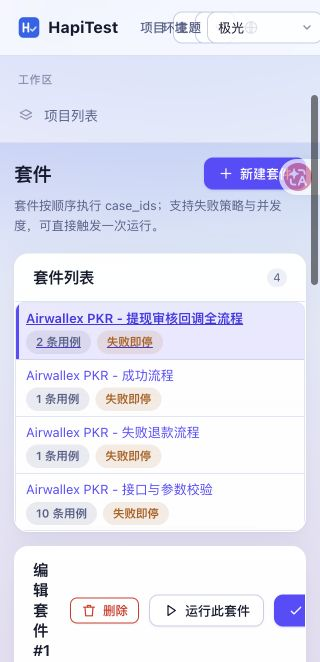

# Airwallex PKR 自动化交付验证

核对日期：2026-10-12。业务接口来源为 hapi-air-v2 当前代码；回调模拟参数已核对项目钉钉文档及官方文档。

| 检查 | 结果 | 范围 |
| --- | --- | --- |
| unittest discover | passed，599 项 | 平台全量回归，HTTP 使用本机模拟服务 |
| tests.test_workflow | passed，6 项 | 成功 / 退款、异步落账、SLS 延迟与错单、缺凭据、超时、SLS 签名、禁止轮询写请求 |
| doctor | ready | 配置、目录、资产、环境 |
| verify | passed，19 项 | 导入 → 套件 → 执行 → 报告 → 项目隔离；[报告](airwallex-pkr-selfcheck.json) |
| node --check | passed | app.js、views/cases.js |
| 浏览器 | passed | 套件绑定沙箱环境；完整步骤显示和保存；控制台无页面错误；页面脚本/样式均为本地资源 |
| Git diff --check | passed | 测试平台与 Wiki 仓库 |
| Wiki check | passed | 记录 ID 关联、SENT/PAID 边界、USD 退款验证 |
| 真实业务环境执行 | not_run | 未配置测试账号、档位、管理员及渠道/SLS API 凭据 |

已同步到本机项目 hapi-air：14 个接口、18 条用例、4 个套件、环境 Airwallex PKR 沙箱。两次同步 ID 保持稳定。

真实运行前按 [使用说明](../testing/AIRWALLEX_PK.md) 补环境变量及确认沙箱 webhook；不能以本机模拟结果代替真实测试服通过。

