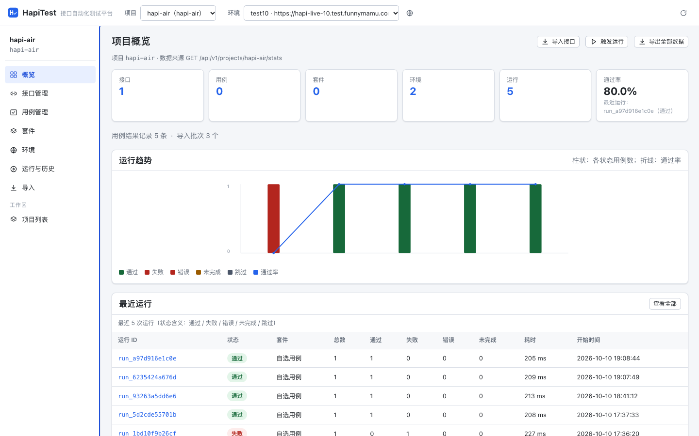
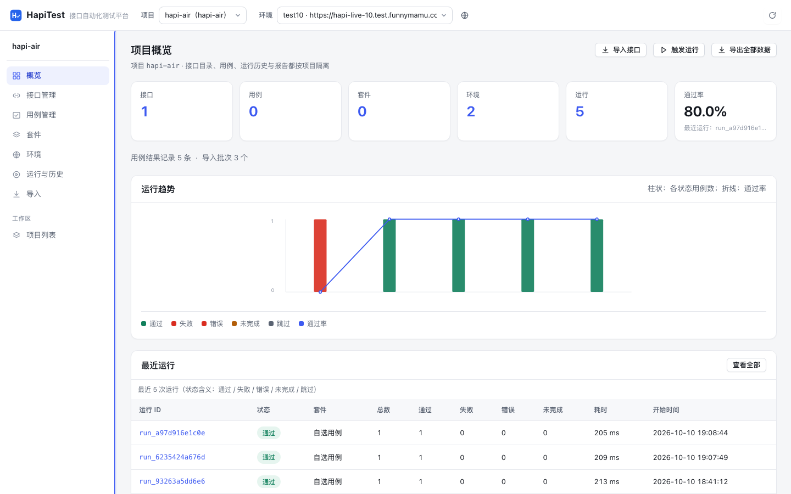
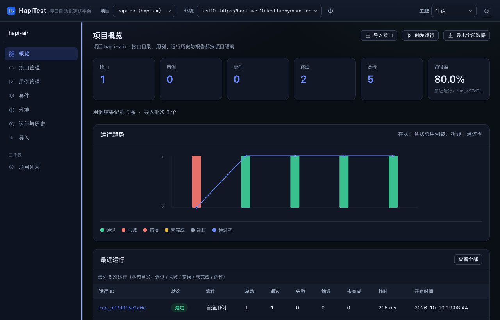
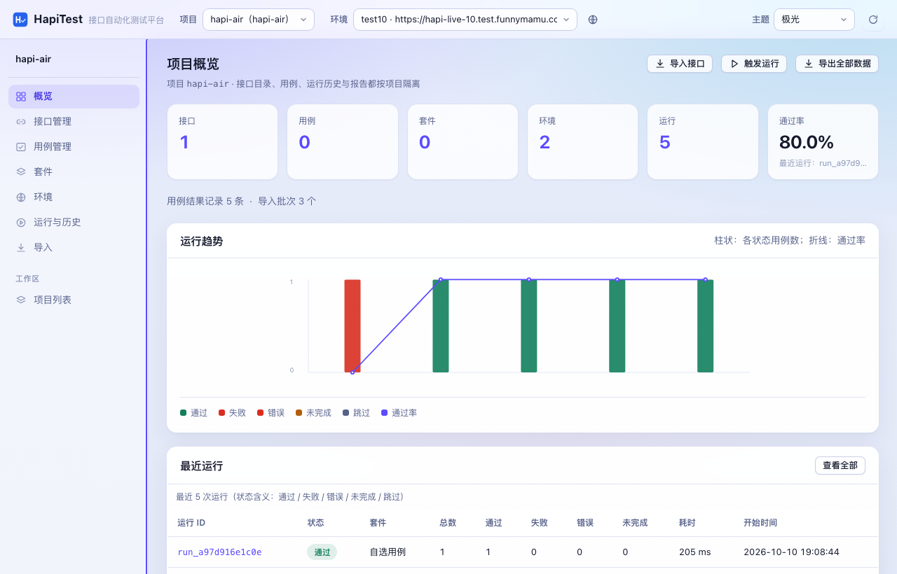
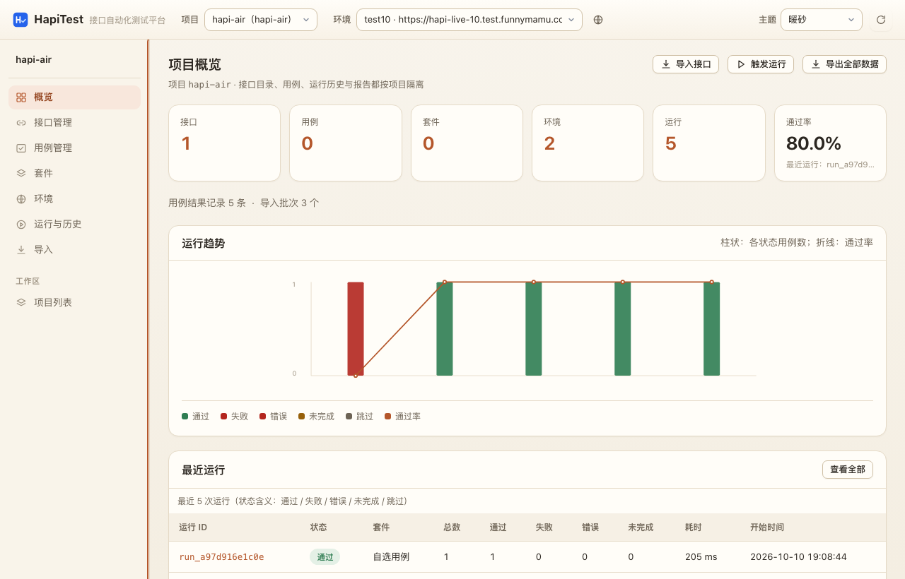
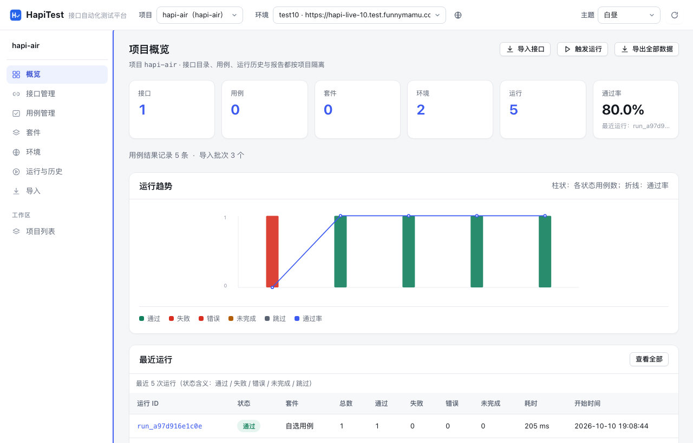

# 验收报告 · hapi-test-platform（HapiTest 0.1.0）

- 验收时间：2026-10-10
- 验收环境：macOS，Python 3.9.6（系统解释器，无第三方包），Node 26（仅用于前端语法检查），无外网访问
- 数据目录：全部使用临时目录（`/tmp/...`），未污染仓库 `data/`
- 结论：**平台自身功能通过验收**；“业务接口是否通过”必须在各自业务环境单独记录，本报告不代替

## 1. 可复现的验证命令

```sh
cd hapi-test-platform
python3 -m unittest discover -s tests -t .     # 586 项单元与接口测试
python3 -m hapitest verify --json docs/reports/selfcheck.json
./scripts/verify.sh                            # 上面两步 + 体检，输出归档到 docs/reports/
```

## 2. 单元与接口测试

| 项目 | 结果 |
|---|---|
| 用例总数 | 586 |
| 通过 | 586 |
| 失败 / 错误 | 0 / 0 |
| 耗时 | 约 16.6 s |
| 联网 | 无（HTTP 相关测试使用本机临时服务 `tests/support.py`） |

覆盖范围：数据模型与校验、项目注册表与项目隔离、接口/用例/套件/环境/运行的仓储、
执行引擎五种终态、导入器（OpenAPI 3 / Swagger 2.0 / Postman / Apifox / curl / Spring 源码 / YAML 子集）、
断言引擎 27 种操作符、JSONPath 子集、变量与提取器、HTTP 客户端（超时/重定向/压缩/Cookie/脱敏/出网限制）、
报告（JUnit XML / HTML / JSON）、HTTP API 与错误信封。

## 3. 端到端自检（`python3 -m hapitest verify`）

自检拉起 `examples/mock_service.py`，在临时数据目录完成
“导入 → 建套件 → 执行 → 报告 → 隔离”全链路，**19/19 项通过**（耗时约 1.0 s）：

| 检查项 | 结果 | 证据 |
|---|---|---|
| `import.parsed` / `import.persisted` | passed | 接口 7 个，用例 7 条 |
| `import.idempotent` | passed | 二次导入：新增 0，更新 0，未变化 14，新增用例 0 |
| `run.smoke_passed` | passed | 状态=passed，通过 7/7 |
| `run.assertion_failure_detected` | passed | 期望值改成 599 → 状态=failed（不是"没报错就算过"） |
| `run.missing_base_url_incomplete` | passed | 无 base_url → 状态=incomplete |
| `run.unreachable_error` | passed | 端口不可达 → 状态=error |
| `report.junit` | passed | XML 中 testcase 7 条 = 运行用例 7 条，可被 `ElementTree` 解析 |
| `report.html` / `report.json` | passed | 25 KB / 25 KB，含运行 ID |
| `isolation.project_scoped` | passed | 另一个项目读到接口 0、用例 0 |
| `isolation.separate_db` | passed | 两个项目两个 `platform.db` 文件 |
| `isolation.path_traversal_blocked` | passed | 非法项目 ID 被拒绝 |

完整明细见 [selfcheck.json](selfcheck.json)。

另有针对性验证（已固化为单元测试）：

- **并发套件**：`concurrency=3`、7 条用例 → 全部通过，7 条结果全部独立落库且 `case_id` 一一对应（`test_concurrent_suite_records_every_case`）。
- **会话串联**：先取 `Set-Cookie` 的用例、再带会话访问的用例，在同一次运行内共享 Cookie Jar（`test_session_cookie_reused_across_cases`）。
- **报告分组**：用例 `folder` 进入 JUnit 的 `classname`（`test_folder_recorded_for_report_grouping`）。
- **导入质量提示**：路径参数缺示例值时逐条提示（`test_quality_warnings_are_merged_into_stats`）。

### 3.1 报告产物抽样检查

| 检查 | 结果 |
|---|---|
| JUnit 根元素 | `<testsuites name="art" tests="7" failures="0" errors="0" skipped="0" time="0.004">` |
| JUnit testsuite | 含 `name/tests/failures/errors/skipped/time/timestamp/hostname` |
| `timestamp` 不带时区后缀 | 是（`2026-10-10T07:21:28`，兼容 JUnit XSD 与 Jenkins/GitLab） |
| testcase | `classname="项目 · 默认环境.健康检查" name="健康检查 - 冒烟" time="0.001"`，含 `<system-out>` |
| XML 非法控制字符 | 无 |
| HTML 报告 | 25 KB，零外部引用（`<script|link|img>` 带 http 的数量 = 0），使用 `<details>`，动态内容已转义 |

### 3.2 验证快照

`docs/reports/verified-manifest.json` 记录了本次验收时 71 个源文件的 SHA-256 前缀与测试结论，
便于日后核对“当时验证的到底是哪一版”。

## 4. 命令行链路（CI 形态）

```sh
python3 -m hapitest --data-dir /tmp/ht-cli project create --name "CLI 演示" --id cli-demo --base-url http://127.0.0.1:8898
python3 -m hapitest --data-dir /tmp/ht-cli import --project cli-demo --file examples/demo_specs/demo_openapi.json --base-url http://127.0.0.1:8898
python3 -m hapitest --data-dir /tmp/ht-cli run --project cli-demo --all --junit /tmp/ht-cli/junit.xml --report-dir /tmp/ht-cli/reports --json /tmp/ht-cli/run.json
```

结果：`状态=passed 通过 7/7`，进程退出码 `0`，生成 JUnit XML / HTML / JSON 三份报告。

**反向验证**：把同一个项目指向一个错误地址时（当时 8899 端口恰好是另一个平台实例），
7 条用例全部判为 `failed` 且退出码为 1，没有出现“环境不对却显示通过”的情况。

## 5. 真实业务仓库接入（关键路径）

### 5.1 从文档地址同步（Swagger 2.0，与工作区现状同构）

```sh
python3 -m hapitest --data-dir /tmp/ht-url3 project create --name "URL 导入" --id url-demo
python3 -m hapitest --data-dir /tmp/ht-url3 import --project url-demo --url http://127.0.0.1:58643/v2/api-docs
python3 -m hapitest --data-dir /tmp/ht-url3 run --project url-demo --all
```

| 观察项 | 结果 |
|---|---|
| 抓取 | `已抓取 http://127.0.0.1:58643/v2/api-docs（4736 字节）` |
| 解析 | 来源=swagger2，接口 7 个，用例 7 条 |
| base_url 自动配置 | 文档 `host` 被写入默认环境（`env base_url = http://127.0.0.1:58643`），无需手填 |
| 运行 | 通过 3/7；失败的 4 条正是导入时已明确警告的“路径参数缺示例值”用例 |
| 导入告警 | `接口 GET /api/users/{id} 的路径参数 id 缺少示例值，生成的冒烟用例使用占位值，请按业务数据填写` |
| 错误格式 | 指向非契约地址时退出码 2，输出 `参数错误：解析失败：无法识别导入格式…`（不是堆栈） |

> 这组结果体现了平台的核心口径：**不知道就说不知道**。平台不会因为“请求发出去了”就算通过，
> 也不会把“路径参数用了占位值 0 导致 404”藏起来——它在导入阶段就明确提示。

### 5.2 Apifox（MCP 通道，真实项目已验证）

**真实项目**：Apifox 项目 `8882175`（hapi-air），令牌放在 `.env.local`（已确认被 `.gitignore` 排除）。

| 观察项 | 结果 |
|---|---|
| 服务 | `Apifox MCP Server 0.0.18`，读主分支，刷新成功，取回 22369 字节 |
| 多文件契约 | 主文档 1 个 path、13 个 schema，另有 **4 个外部 `$ref` 被自动内联**（Apifox 的拆包导出） |
| 解析入库 | 接口 1 个（`GET /activity/room-activity/rewards`），用例 1 条，写入 `hapi-air` 项目 |
| base_url | 沿用该项目已有的环境配置 `https://hapi-live-10.test.funnymamu.com`（用户自行配置，未被覆盖） |
| 真实执行 | **HTTP 200、207ms、`{"code":200}` → 用例 passed** |
| 分支参数 | `--branch-id` 已打通（源码级确认：`--branch-id` → `X-Branch-Id` + 导出请求体 `branchId`） |
| 未知分支 | 传非法分支 ID 时不报错、回落到主分支内容（`mcp.branch_id` 原样记录，便于事后核对） |

这次真实接入暴露并修掉了三个问题（只有拿真实契约跑才会出现）：

1. **可选参数被丢弃**：契约里 `actType=2`、`uid=21018344` 是可选但有示例值，旧策略一律不发送 →
   真实服务返回 `400 {"code":-500,"message":"system error"}`。现在"有示例值就发送"。
2. **敏感参数被清空后无法使用**：`Platform-Auth` 命中敏感词被置空 → 现在改写为 `${Platform-Auth}`
   并启用，在环境变量里定义同名变量即可跑通；同时运行日志会明确写"以下变量未定义"。
3. **契约更新不会同步到已生成用例**：导入是只增不改的幂等策略，导致修好策略后旧用例仍是坏的。
   新增显式开关 `--refresh-cases`（只覆盖请求模板与断言，保留人工维护的字段）。

```sh
printf 'APIFOX_ACCESS_TOKEN=%s\n' '<令牌>' >> .env.local     # .env.local 已被 .gitignore 排除
python3 -m hapitest --data-dir /tmp/ht-mcp import --project apifox --mcp-project 123456
```

| 观察项 | 结果 |
|---|---|
| 服务握手 | `MCP 同步：服务=Fake Apifox MCP 0.0.0，工具=read_project_oas_abc123，刷新=是，取回 7068 字节` |
| 解析入库 | 来源=apifox，接口 7 个，用例 7 条，新增用例 7 |
| base_url | 自动从文档 `servers` 探测并写入默认环境 |
| 接口通道 | `POST /api/v1/projects/{pid}/imports/mcp` 预览与入库均验证通过（预览 7 接口 / 7 用例，入库 新增 7 / 用例 7） |
| 界面 | `导入 → Apifox（MCP）` 面板渲染正常，批次历史记录正确 |
| 令牌 | 只从服务端环境变量或 `.env.local` 读取，**加入后无需重启**（实测在运行中的实例上直接生效） |
| 真实 Apifox 项目 | **未验证**：没有可用的 Apifox 项目 ID 与访问令牌，MCP 通道是用本地假 MCP 服务（`tests/fake_mcp_server.py`）做的端到端验证 |

### 5.3 反复同步（真实工作流：每天导出一次契约）

```sh
cp examples/demo_specs/demo_openapi.json /tmp/ht-final/api-1010.json
cp examples/demo_specs/demo_openapi.json /tmp/ht-final/api-1011.json
cp examples/demo_specs/demo_openapi.json /tmp/ht-final/api-1012.json
# 依次 import 三个文件
```

| 次序 | 结果 |
|---|---|
| api-1010.json | 新增 7，更新 0，未变化 0，新增用例 7 |
| api-1011.json | 新增 0，更新 0，未变化 14，新增用例 0 |
| api-1012.json | 新增 0，更新 0，未变化 14，新增用例 0 |
| 最终 | 接口 7，用例 7（没有重复） |

结论：同一份契约反复导出、换文件名再同步是安全的；"更新 0" 也准确反映了"这次同步没有改动任何接口定义"。

### 5.4 源码扫描（Spring / springfox）

对工作区真实 Java 仓库 `../hapi-mamu-v2` 执行源码扫描：

```sh
python3 -m hapitest --data-dir /tmp/ht-scan2 import --project mamu --scan ../hapi-mamu-v2
```

| 指标 | 结果 |
|---|---|
| 解析耗时 | 约 14 s（含入库） |
| 解析到的映射 | 878 |
| 去重后接口（`method + path`） | 870 |
| 生成冒烟用例 | 858 |
| 目录（Controller） | 213 |
| 方法分布 | GET 777，POST 93 |
| 含路径参数的接口 | 15 |
| 含请求体的接口 | 128 |
| 含查询参数的接口 | 666 |
| 警告 | 438（类未声明类级 `@RequestMapping`、默认 GET、未知类型按 object 处理等，逐条列出） |

明细见 [spring_scan_evidence.json](spring_scan_evidence.json)。

> 为什么用源码扫描：本工作区 Java 服务使用 springfox 2.7（Swagger 2.0），
> 文档地址是 `/v2/api-docs?group=<group>`，且 Docket 通常只在 dev/test 开启、
> 只暴露带 `@ShowMeOnSwaggerUI` 的控制器（`hapi-mamu-v2` 中 221 个控制器文件里只有 2 个）。
> 因此“扫描源码”是覆盖率最高的同步方式，文档导入作为补充。

## 6. Web 控制台

真实后端 + 无头 Chrome（`--headless=new --dump-dom`）渲染验证：

| 路由 | 结果 |
|---|---|
| `#/projects` | 渲染 1 个项目、7 接口 / 7 用例 / 1 环境，含新建与删除确认 |
| `#/p/demo/dashboard` | 渲染统计卡片与最近运行面板 |
| `#/p/demo/cases` | 渲染 7 条用例（目录/方法/路径/优先级） |
| `#/p/demo/runs` | 渲染触发面板、筛选器、状态说明 |
| `#/p/demo/runs/run_4aec6adb4a17` | 渲染 7/7 通过、逐用例「断言 5/5 通过」、运行日志、对比入口 |

静态资源：`/`、`/assets/app.js`、`/assets/api.js`、`/assets/styles.css`、`/assets/views/*.js`、
`/assets/favicon.svg` 均返回 200 与正确 Content-Type；无外部 CDN 引用。

已知待修（前端，不影响平台功能）：无。
以下问题已在前端点检后修复并复测：概览页空数据时的 `[object HTMLDivElement]`、
深链 `#/p/<id>/cases/<id>` 误渲染为“新建用例”、`[hidden]` 被组件样式顶掉、
`truncate()` 自引用 TDZ、选中态样式缺失。

### 6.1 真实浏览器点检（由前端负责人在 CDP 驱动下执行）

对接真实后端 + mock 服务，15/15 步通过，控制台消息 0 条：

创建/删除项目（含输入 id 确认）、接口列表、试跑（`HTTP 200 · GET http://127.0.0.1:8898/api/health`）、
生成用例并跳转、单用例运行返回 `CaseResult`、触发套件运行 → 运行详情（总 3/通过 3/未完成 0）→
轮询到终态、`report?format=xml`（`<testsuites name="demo" tests="3">`）、HTML 报告、用例手风琴、
导入预览。另有 11 条路由 × 1440/1024 的 DOM 快照，控制台错误数均为 0；
`grep -rInE "https?://" hapitest/web/` 的 8 处命中全部是 SVG 命名空间与输入框示例文案，无外部请求。

## 7. 实时运行证据（真实服务端）

```sh
python3 -m hapitest --data-dir /tmp/ht-live2 serve --demo --port 57688
curl -X PUT .../environments/1      # base_url 指向 mock 服务
curl -X POST .../runs -d '{"suite_id":1,"background":false}'
```

返回：`status=passed total=7 passed=7 failed=0 errored=0 incomplete=0 skipped=0`，运行 ID `run_4aec6adb4a17`。

### 7.1 运维脚本（start.sh / stop.sh）

用临时数据目录与空闲端口实测：

| 步骤 | 结果 |
|---|---|
| `./start.sh start` | 启动成功，打印 pid、访问地址、日志路径、数据目录 |
| `./start.sh status` | 显示运行中并完成健康检查：`HapiTest 0.1.0，项目数 0` |
| 再次 `./start.sh start` | 识别为已运行，不重复启动 |
| `./start.sh stop` | 停止进程；随后端口不再监听、`status` 返回“未在运行” |

过程中发现并修复了一个真实缺陷：macOS 自带 bash 3.2 会把 `"（pid=$pid）"` 中的
`$pid）` 当作一个变量名（全角字符未被视为分隔符），在 `set -u` 下报
`pid）: unbound variable`，导致启动/停止提示异常。已改为 `${pid}` 显式界定变量名，
并对全部 shell 脚本做了同样的模式扫描（`grep -n '\$[A-Za-z_][A-Za-z0-9_]*[^ -~]'`）与 `bash -n` 语法检查。

## 8. 未验证 / 明确不在本期范围

| 项 | 说明 |
|---|---|
| 真实业务接口回归 | 未对任何真实测试环境发请求；接入后需在项目侧单独记录 |
| 数据库层校验 | 平台只做 HTTP 层断言，不直连业务库比对 |
| 进程级沙箱 | 用例在平台进程的线程中执行，靠超时与取消控制；不用于执行不受信代码 |
| 文件上传（multipart 文件字段） | 当前只支持文本字段 |
| Postman `pm.*` 脚本 | 只翻译可识别的状态码/期望断言，其余记为警告，不执行 JS |
| Linux / Windows 运行 | 仅在 macOS + Python 3.9.6 上验证 |

## 9. 复现说明

- 所有验证均在临时数据目录执行，仓库内 `data/` 为空。
- 自检与测试都不访问外网；扫描证据来自本机工作区源码。
- 报告中每一处“通过”都对应上文列出的命令与输出，未运行的检查不做推断。

## 10. 验证过程中发现并修复的真实缺陷

这些都是“只有真的跑起来才会暴露”的问题，逐条记录以便回溯：

| # | 缺陷 | 影响 | 修复 |
|---|---|---|---|
| 1 | `sqlite3.Connection` 被执行线程与请求线程共用 | 并发下 SQLite 崩溃（解释器 **Segmentation fault**），运行卡在 `queued` | 改为每线程独立连接 + `busy_timeout`，写操作用仓储级锁 |
| 2 | `run` 表缺少 `incomplete` 列 | 写运行结果直接报 `no such column` | 补列（`ensure_schema` 幂等迁移）与序列化 |
| 3 | `_RequestHandler` 读 `self.app`，而 App 挂在 server 上 | 整个 Web 服务 500 / 无响应 | 改为 `self.server.app` 属性访问 |
| 4 | `endpoint.path` 与 `endpoint.request.path` 可能不一致 | “试跑”等操作请求到 `/`，全部 404 | 模型层统一：接口级 method/path 为权威值，落库前同步 |
| 5 | 路径参数被示例值替换后，用例无法关联回接口 | 3/7 生成用例 `endpoint_id` 为空，失去可追溯性 | 新增路径模板匹配 `find_endpoint_for_path`，并补测试 |
| 6 | 导入器把类型默认值（如 `0`）当示例值，用户只看到莫名 404 | 首次接入体验差、失败原因不明确 | 新增导入质量提示 `quality_warnings`，明确要求补业务数据 |
| 7 | 解析失败抛出裸 `ValueError` | CLI 打印堆栈而不是错误信息 | `sync.load_import` 统一转 `ValidationError`，CLI 退出码 2 |
| 8 | macOS bash 3.2 把 `$pid）` 当成变量名 | `start.sh` 在 `set -u` 下报 unbound variable，启动/停止提示异常 | 改用 `${pid}`，并对全部脚本做同类模式扫描 |
| 9 | 前端 `truncate()` 自引用 TDZ | 渲染请求/响应体时抛 `ReferenceError` | 前端修复（DOM-shim 冒烟捕获，`node --check` 查不出） |
| 10 | 看板空态把 DOM 节点当字符串插入 | 页面出现 `[object HTMLDivElement]` | 前端修复，并补空数据回归场景 |
| 11 | `[hidden]` 被组件 `display` 覆盖 | 顶栏常显“加载中…”、多个面板同时可见 | 前端加全局 `[hidden]{display:none!important}` |
| 12 | 生成用例的 `source_ref` 用的是文档路径 | 契约每次导出成新文件名再同步就会**重复建用例**（真实工作流：每天导出一次 → 用例无限增长） | 绑定阶段把 `source_ref` 规范为接口签名（`GET /api/users/{id}`），并以接口维度判重 |
| 13 | 接口"是否变化"的判定包含 `source_ref` | 换文件名同步会把全部接口报成"已更新"，"这次同步改了什么"的信号失效 | 比较时忽略 `source_ref`（出处仍静默刷新），新增断言 `test_resync_does_not_report_false_updates` |

第 1、2、4、5、6、7、8、12、13 项由本轮验收直接发现；第 3、9、10、11 项由前端负责人发现。
第 12、13 项来自导入器负责人主动报告的接口偏差，已在验收阶段复现并修复。

## 11. 界面视觉改版（2026-10-12）

对控制台做了一次完整的设计令牌重构 + 组件精修，功能与信息架构不变。

| 改动 | 说明 |
|---|---|
| 设计令牌 | 统一的灰阶/描边/三级文本、单一靛蓝主色、降饱和状态色、三级圆角与阴影、控件高度与顶栏高度变量 |
| 排版 | 正文 13.5px / 行高 1.6，标题层级收紧字距；数字与 ID 使用 `tabular-nums` 对齐 |
| 顶栏 / 侧栏 | 侧栏导航改为 34px 圆角条目（选中为浅色胶囊 + 主色图标），项目名与 ID 重复时不再重复显示 |
| 卡片 / 表格 | 卡片 12px 圆角 + 极轻阴影；表头 12px 中性色、行高 10/14、短列不折行、长文本用 `.cell-wrap` 显式换行 |
| 表单 / 按钮 | 统一 32px 控件高度、8px 圆角、悬停描边加深、聚焦 3px 主色光环；原生 select 自绘下拉箭头 |
| 图表 | 柱体改为降饱和 + 圆角端点，趋势点改为空心圆，图例加分隔线与色块 |
| 文案 | 去掉界面上的接口路径噪音（如"数据来源 GET /api/v1/…"），改为对用户有意义的说明 |

改动集中在 `hapitest/web/styles.css`（设计令牌 + 组件规则）与三处视图文案；选择器集合经脚本校验为
249 → 258（**无丢失**），花括号平衡，593 项测试与 19 项自检保持全绿。





## 12. 主题系统（2026-10-12）

把界面从"单一浅色"改成**四套可选主题 + 顶栏切换器**，选择保存在浏览器本机（`localStorage`），
首屏由内联脚本在样式加载前应用，不会出现"先白后黑"的闪烁。

| 主题 | 定位 | 关键差异 |
|---|---|---|
| **午夜** `midnight` | 深色（可切换） | 三层表面（背景/卡片/浮起）+ 顶边高光做层次；主色辉光背景；原生控件跟随深色 |
| **极光** `aurora` | 浅色渐变玻璃，**默认主题** | 三团径向渐变背景，卡片半透明 + 背景模糊 + 白色描边 |
| **暖砂** `sand` | 暖色纸张感 | 米色底 + 陶土主色，圆角加大到 14px，阴影更柔 |
| **白昼** `daylight` | 中性浅色 | 即最初的默认样式，保留给习惯浅色的人 |

- 切换入口：顶栏右侧「主题」下拉；也支持 `/?theme=midnight` 直接指定（截图与分享用）。
- **默认主题为极光**（首次访问即生效，已用"全新浏览器配置、无本地存储"实测）；
  不跟随系统深浅色自动切换，避免界面忽明忽暗 —— 喜欢深色的人在顶栏切到「午夜」即可，选择记在本机。
- 主题只影响设计令牌与少量表面规则，不改任何功能与信息架构。








